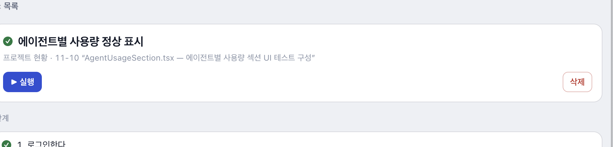

# UI 테스트 에이전트 소개 (베타)

화면 이름만 말하면 AI 가 소스를 읽어 테스트를 만들고, 내 PC 의 브라우저로 실행해 결과서까지 남겨 주는 lite-harness 플러그인(`ui-test`)입니다.

## 한 줄 요약

> "가입설계 화면 테스트 구성해 줘" → 시나리오 초안 → 사용자가 고름 → 테스트 코드 생성 → 실행 → 단계별 스크린샷이 든 결과서

## 해결하는 문제

| 지금 | ui-test 를 쓰면 |
|---|---|
| 화면 테스트를 사람이 시나리오 문서로 쓰고, 자동화 코드는 따로 짠다 | AI 가 화면 소스(필요하면 백엔드 코드)를 읽어 시나리오와 코드를 함께 만든다 |
| 어떤 시나리오를 만들지 AI 가 마음대로 정한다 | 초안을 번호 목록으로 보이고 사용자가 **고른 것만** 저장한다 |
| 화면이 바뀌면 테스트가 조용히 낡는다 | 시나리오가 바뀌면 "코드 낡음", 읽은 소스가 바뀌면 "코드 바뀜"으로 알려 주고 보강을 제안한다 |
| 실패하면 원인 찾기가 막막하다 | AI 가 재현 → 다른 방법 시도 → 그래도 안 되면 사용자에게 한 가지씩 묻는다 |
| 결과를 남기기 번거롭다 | 시나리오마다 결과서(HTML · PDF)와 지난 실행 대비 변화(새로 실패 · 고쳐짐 · 그대로 실패)를 남긴다 |

## 어떻게 일하나

1. **만들기** — 대화에서 화면을 가리키면 AI 가 소스를 읽고 시나리오 초안을 낸다. 사용자가 여러 개 고르기로 고른다.
2. **저장** — 고른 것만 `<프로젝트>/.litecode/plugins/ui-test/scenarios/` 에 시나리오(md)와 실행 코드(`.spec.mjs`)로 저장한다.
3. **실행** — 오른쪽 패널의 [▶ 실행]. PC 에 설치된 Chrome(없으면 Edge)이 단계마다 스크린샷을 찍으며 돈다.
4. **결과** — 시나리오마다 결과서, 필요하면 화면 흐름을 사진으로 풀어 쓴 화면 가이드. 둘 다 PDF 로 저장할 수 있다.
5. **고치기** — 패널의 [수정] 으로 새 대화를 열면 AI 가 무엇을 바꿀지 묻고, 바꾸기 전에 전·후를 보여 준 뒤 반영한다. [보강] 은 빠진 확인이나 데이터 변형을 제안한다.

시나리오 상세 화면의 한 장면입니다 — 제목, 어느 화면 · 어떤 요청에서 만들어졌는지, [▶ 실행] 과 아래의 단계 목록이 보입니다. (이 캡처는 [수정] 단추가 생기기 전 화면입니다.)

## 에이전트의 약속 (스킬 규칙)

- **테스트 대상 앱의 소스는 고치지 않는다.** 오류가 나도 시나리오와 테스트 코드만 고치거나, 앱 결함으로 보이면 근거와 함께 보고한다.
- **서버가 코드와 다르게 동작하면** 최신 코드를 받아 다시 비교하고, 그래도 이상하면 사용자에게 묻는다.
- 원인은 확인한 뒤에만 말한다. 보안 제품이나 네트워크 탓을 검증 없이 하지 않는다.
- 저장된 시나리오는 사용자 확인 없이 바꾸지 않는다.
- 도구가 대화에 붙지 않았으면 우회하지 않고 멈춰서 안내한다.

## 구성

| 부분 | 하는 일 |
|---|---|
| 패널 | 시나리오 목록·상세, 실행, 수정·보강, 결과 보기 |
| 스킬 `ui-test` | 시나리오 만들기 · 보강 · 수정 · 낡은 코드 갱신 |
| 스킬 `ui-test-run` | 실행, 실패 해결, 수행 기록 |
| 실행기 서버 | Playwright 로 PC 브라우저를 띄워 실행하고 기록을 남긴다 |

## 안전 · 폐쇄망

- 시나리오·결과서는 프로젝트의 `.litecode/plugins/ui-test/` 아래에만 남는다. 플러그인을 지우면 이 폴더도 안내 뒤 함께 지워진다.
- 테스트 계정 비밀번호는 앱이 이 기기에 암호화해 보관하고, 결과서와 도구 결과에는 넣지 않는다.
- 필요한 것은 모두 플러그인에 담겨 있어 설치 뒤 바깥에서 내려받지 않는다. 테스트는 사용자가 적은 대상 주소로만 나간다.
- 권한은 서비스 · 프로젝트(결과서 열기·저장) · 채팅(새 대화 요청) 세 가지다.

## 현재 한계 (베타)

- 대상 주소 · 브라우저 · 테스트 계정을 프로젝트마다 설정해야 한다. 계정은 하나만 지원한다.
- PC 에 Chrome 이나 Edge 가 있어야 한다.
- DB 값을 확인하는 단계(`확인(DB):`)는 대화에서만 확인한다. 패널 실행에서는 자동으로 돌지 않는다.
- PDF 저장은 앱이 저장 창을 지원할 때만 된다.
- 시나리오마다 최근 20개 결과만 남긴다.
- AI 가 만든 시나리오이므로 처음 몇 번은 사람이 초안과 결과를 확인하는 것을 권한다.

## 더 보려면

- 구현·구조: `plugins/ui-test/README.md`
- 스킬 규칙: `plugins/ui-test/skills/ui-test/SKILL.md`, `plugins/ui-test/skills/ui-test-run/SKILL.md`
- 바뀐 점: `plugins/ui-test/changes.txt`
