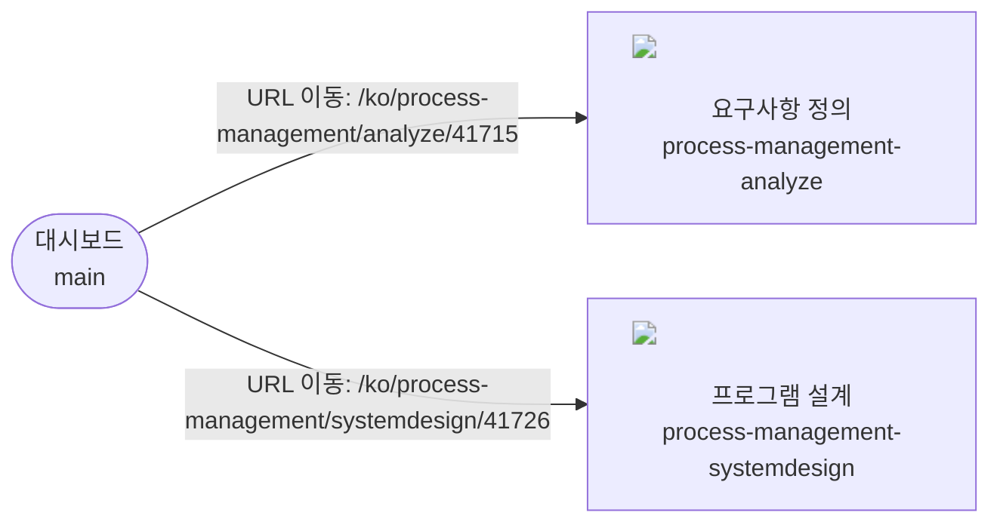

# system_map

페이지(노드)와 이동(간선)의 관계. 흐름도와 페이지 설명은 아래 두 표에서 만든다. 작성 규칙은 `.opencode/skills/evidence-manage/SKILL.md` 참고.

## 진입점
| page_id | 진입 방법 |
|---|---|
| main | https://portal.example.test/ko 로 이동 (로그인 상태 유지, UI-AUTO 세션) |

## 페이지 목록
| page_id | 화면명 | URL 패턴 | 도착 확인 방법 | 문서 | 최근 확인일 |
|---|---|---|---|---|---|
| main | 대시보드 | /ko | URL이 /ko 로 끝남 + Page Title "대시보드 \| Portal" | pages/main.md | 2026-11-10 |
| process-management-analyze | 요구사항 정의 | /ko/process-management/analyze/* | URL이 /ko/process-management/analyze/ 로 시작 + heading "요구사항 정의" 표시 | pages/process-management-analyze.md | 2026-11-10 |
| process-management-systemdesign | 프로그램 설계 | /ko/process-management/systemdesign/* | URL이 /ko/process-management/systemdesign/ 로 시작 + heading "프로그램 설계" 표시 | pages/process-management-systemdesign.md | 2026-11-10 |

## 이동 관계
| edge_id | 출발 | 동작 | 대상 요소(역할·이름) | 전제조건 | 도착 | 이동 스크립트 | 최근 확인일 | 상태 |
|---|---|---|---|---|---|---|---|---|
| main__process-management-analyze | main | URL 이동 | (직접 URL: /ko/process-management/analyze/41715) | 로그인 상태, 관리 서브프로젝트 analyze 공정 선택됨 | process-management-analyze | scripts/routes/main__process-management-analyze.yaml | 2026-11-10 | 유효 |
| main__process-management-systemdesign | main | URL 이동 | (직접 URL: /ko/process-management/systemdesign/41726) | 로그인 상태, 관리 서브프로젝트 design 공정 선택됨 | process-management-systemdesign | scripts/routes/main__process-management-systemdesign.yaml | 2026-11-10 | 유효 |

## 흐름도

## 페이지 설명
### main 대시보드
캡처 없음 (아직 테스트 대상이 된 적 없음)

- 설명: 로그인 후 처음 열리는 화면. 프로젝트 정보와 서브프로젝트 진척률, 내 작업, 공지사항, 캘린더 등 카드가 표시된다. 좌측 메뉴로 각 관리 영역으로 이동한다.
- 주요 요소: combobox "프로젝트를 선택하세요", link "대시보드", button "내 작업", button "일정 관리", button "공정상세 관리", button "품질 관리", button "위험 관리", button "의사소통 관리"
- 들어가는 방법: 진입점. https://portal.example.test/ko 로 이동

### process-management-analyze 요구사항 정의

- 설명: 관리 서브프로젝트의 요구사항을 정의·조회·등록하는 화면. 요구사항 목록 표(총 N건)와 "추가하기"로 등록 다이얼로그를 열어 신규 요구사항을 만든다.
- 주요 요소: button "워크플로 보기", button "페이지 설정", tab "조회", button "추가하기", button "저장", textbox "검색명을 입력하세요", status "총 N", table 요구사항 목록, 요구사항 정의 등록 다이얼로그
- 들어가는 방법: main → process-management-analyze (edge: main__process-management-analyze). 메뉴 링크 클릭은 클라이언트 예외로 실패하므로 직접 URL로 이동
- 테스트 케이스: 2건 (성공 2)

### process-management-systemdesign 프로그램 설계

- 설명: 관리 서브프로젝트의 프로그램 설계 항목(설계 ID SD-NNNNNN)을 등록·조회하는 화면. 설계 목록 표(총 N건)와 "추가하기"로 "프로그램 설계 등록" 다이얼로그를 열어 신규 설계 항목을 만든다.
- 주요 요소: button "워크플로 보기", tab "조회", button "추가하기", button "저장", textbox "검색명을 입력하세요", status "총 N", table 설계 항목 목록, 프로그램 설계 등록 다이얼로그
- 들어가는 방법: main → process-management-systemdesign (edge: main__process-management-systemdesign). 메뉴는 공정상세 관리→설계→프로그램 설계, 직접 URL로 이동
- 테스트 케이스: 1건 (성공 1)
